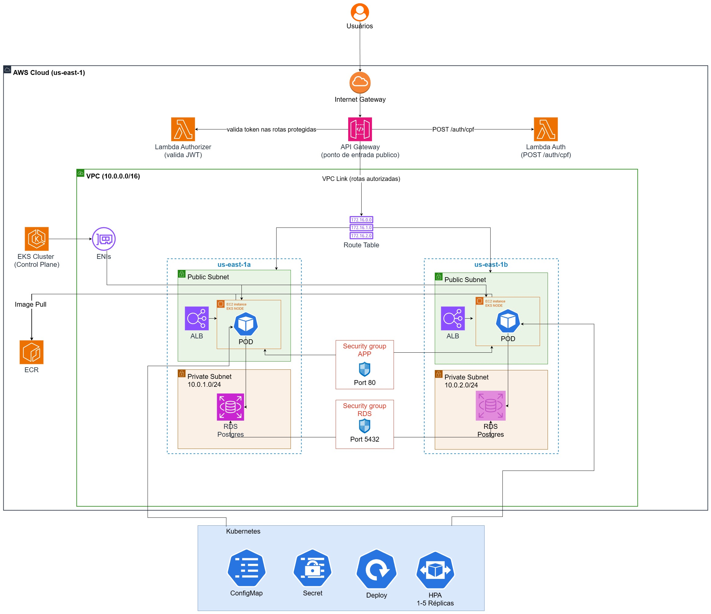
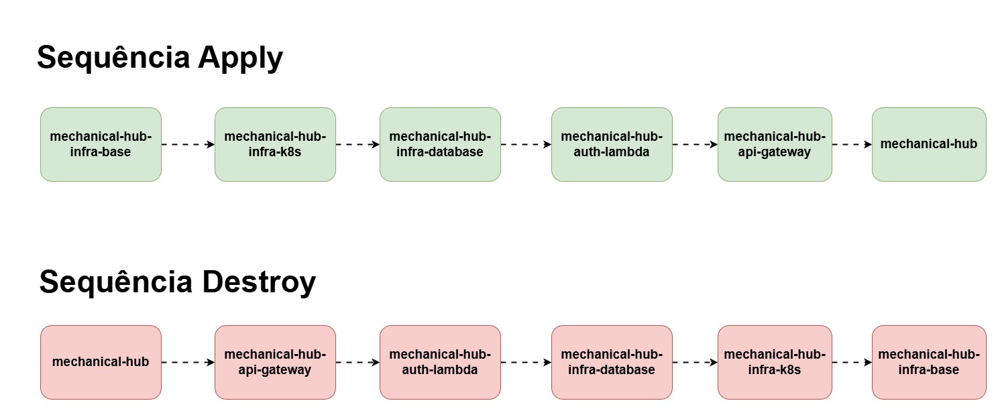

# mechanical-hub-infra-base

Camada de infraestrutura mais fundamental do projeto mechanical-hub: e o primeiro
repositorio a ser aplicado, e todos os outros dependem dos recursos que ele cria para funcionar.

Recursos de base do projeto mechanical-hub: VPC, subnets, Internet Gateway, route
tables, os security groups (`alb`, `app`, `rds`, `lambda_auth`) e o repositorio ECR.

## Tecnologias

- **Terraform** (`hashicorp/aws ~> 5.0`) — toda a infraestrutura deste repo.
- **AWS**: VPC, subnets, Internet Gateway, route tables, Security Groups, ECR.
- **GitHub Actions** — pipelines de validacao (feature) e apply/destroy (main).
- **S3** — backend remoto do state Terraform (`mechanical-hub-tfstate`), com locking nativo (`use_lockfile`) e versionamento, criado e gerenciado pela propria pipeline deste repo.

## Diagrama de arquitetura



## Passos para execucao e deploy

**Este repo nao depende de nenhum outro — e o primeiro a ser aplicado.** Todos os
demais repos de infraestrutura (`infra-k8s`, `infra-database`, `auth-lambda`,
`api-gateway`) dependem dele, consumindo VPC/subnets/security groups/ECR via data
source. Ordem completa de subida, do primeiro ao ultimo: **infra-base → infra-k8s →
infra-database → auth-lambda → api-gateway** (e so depois o repo da aplicacao,
`mechanical-hub`, que precisa do EKS e do RDS no ar). Para derrubar tudo ao fim da
sessao do AWS Academy, a ordem e a inversa: api-gateway → auth-lambda →
infra-database → infra-k8s → infra-base.



Mesmo padrao operacional do repo da aplicacao: um arquivo commitado (`infra/pipeline.conf`)
decide o que a pipeline faz, e todo push em `main` dispara a esteira.

1. Configurar no repositorio os secrets `AWS_ACCESS_KEY_ID`, `AWS_SECRET_ACCESS_KEY` e
   `AWS_SESSION_TOKEN` com as credenciais AWS Academy.
2. No inicio da sessao do AWS Academy, garantir `infra/pipeline.conf` com
   `DESTROY=false`, commitar na sua branch feature e depois merge em `main`.
3. A pipeline cria (se ainda nao existir) e ativa o versionamento do bucket
   `mechanical-hub-tfstate`, inicializa o backend na key
   `infra-base/terraform.tfstate` e aplica `vpc.tf`, `sg.tf` e `ecr.tf`.
4. Conferir os outputs publicados ao final do job (`terraform output`) ou na aba do
   workflow.
5. Os repos de ciclo curto (infra-k8s, infra-database, api-gateway) passam a consumir
   estes recursos via data source — nao duplicar a criacao de VPC, SGs ou ECR neles.
6. Antes da sessao do AWS Academy encerrar (janela de 4h), mudar
   `infra/pipeline.conf` para `DESTROY=true` e subir ate a branch `main` — a pipeline roda
   `terraform destroy`.

## Decisoes arquiteturais relacionadas

RFCs e ADRs ficam centralizados no repo da aplicacao, para nao duplicar/desincronizar entre os 6 repositórios. As diretamente relevantes para este repo:

- [RFC-001 — Escolha da nuvem e restricoes do AWS Academy Learner Lab](https://github.com/estefanyneres/mechanical-hub/blob/main/src/docs/fase3/documentacao/rfcs.md)
- [RFC-005 — Credenciais estaticas renovadas por sessao (OIDC inviavel)](https://github.com/estefanyneres/mechanical-hub/blob/main/src/docs/fase3/documentacao/rfcs.md)
- [ADR-002 — Descoberta entre repositorios via data source](https://github.com/estefanyneres/mechanical-hub/blob/main/src/docs/fase3/documentacao/adrs.md)
- [ADR-003 — Security groups centralizados em `infra-base`](https://github.com/estefanyneres/mechanical-hub/blob/main/src/docs/fase3/documentacao/adrs.md)
- [ADR-005 — Separacao de repositorios por taxa de mudanca](https://github.com/estefanyneres/mechanical-hub/blob/main/src/docs/fase3/documentacao/adrs.md)


## Descoberta entre repos

Via **data source**, nao via remote state. Data source consulta o estado real na AWS;
remote state le o que o Terraform acha que existe. Exemplo de lookup em outro repo:

```hcl
data "aws_vpc" "base" {
  filter {
    name   = "tag:Name"
    values = ["mechanical-hub"]
  }
}

data "aws_subnets" "private" {
  filter {
    name   = "vpc-id"
    values = [data.aws_vpc.base.id]
  }
  tags = { Tier = "private" }
}

data "aws_security_group" "app" {
  filter {
    name   = "tag:Name"
    values = ["mechanical-hub-app-sg"]
  }
}

data "aws_ecr_repository" "app" {
  name = "mechanical-hub"
}
```

## Outputs publicados

| Output               | Descricao                              |
|-----------------------|-----------------------------------------|
| `vpc_id`              | ID da VPC                              |
| `public_subnet_ids`   | IDs das subnets publicas               |
| `private_subnet_ids`  | IDs das subnets privadas               |
| `alb_sg_id`           | ID do security group do ALB            |
| `app_sg_id`           | ID do security group da aplicacao      |
| `rds_sg_id`           | ID do security group do RDS            |
| `lambda_auth_sg_id`   | ID do security group da Lambda de autenticacao |
| `ecr_url`             | URL do repositorio ECR                 |

## Pipelines

- `pipeline-infra-feature.yml`: dispara em push para `feature/*`. Roda
  `terraform fmt -check`, `init -backend=false` e `validate` — checagem de
  sintaxe/consistencia do HCL, sem credenciais AWS e sem depender do bucket
  do state ja existir. Abre PR automatico para `main` se tudo passar —
  equivalente ao `feature.yml` do repo da aplicacao (build+test), so que
  validando a infra em vez de compilar Java.
- `pipeline-infra-main.yml`: dispara em push para `main` (ou
  `workflow_dispatch`). Cria/versiona o bucket do state, roda `terraform
  init` contra o backend real e le `infra/pipeline.conf` pra aplicar ou
  destruir conforme `DESTROY` — equivalente ao `main.yml` do repo da
  aplicacao. E o unico ponto que fala com a AWS de verdade; por isso nao
  repete o `validate` que ja rodou na feature.

## Estrutura

```
mechanical-hub-infra-base/
├── .github/workflows/
│   ├── pipeline-infra-feature.yml
│   └── pipeline-infra-main.yml
├── docs/
│   ├── desenhos/
│   │   ├── mechanical-hub-infraestrutura-fase-03.jpg
│   │   └── mechanical-hub-apply-destroy-repos-fase-03.jpg
├── infra/
│   ├── providers.tf
│   ├── variables.tf
│   ├── vpc.tf
│   ├── sg.tf
│   ├── ecr.tf
│   ├── outputs.tf
│   └── pipeline.conf
├── .gitignore
└── README.md
```
